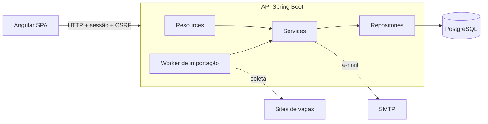

# Acompanha Aí

[](https://github.com/acompanhaai-project/acompanhaai-v1/actions/workflows/backend-ci.yml)
[](https://github.com/acompanhaai-project/acompanhaai-v1/actions/workflows/frontend-ci.yml)


Aplicação web para organizar a busca por emprego. Cada vaga vira uma
candidatura acompanhada por etapas, do cadastro à proposta, e uma vaga pode
ser importada colando o link ou a descrição, sem preencher tudo à mão.

## Sumário

- [Funcionalidades](#funcionalidades)
- [Arquitetura](#arquitetura)
- [Tecnologias](#tecnologias)
- [Como executar](#como-executar)
- [Testes e qualidade](#testes-e-qualidade)
- [Estrutura do repositório](#estrutura-do-repositório)
- [Documentação](#documentação)
- [Roadmap](#roadmap)
- [Contribuição](#contribuição)

## Funcionalidades

### Contas e acesso

- Cadastro, login e logout com sessão no servidor e proteção CSRF.
- Recuperação de senha por link de uso único enviado por e-mail.
- Perfil com foto opcional, validada pelo conteúdo e regravada sem metadados.
- Isolamento completo entre contas: registros de outra conta respondem `404`.

### Candidaturas

- Cadastro manual da vaga com empresa, localização, modalidade, salário e
  habilidades técnicas e comportamentais.
- Oito etapas de acompanhamento (`SAVED`, `APPLIED`, `SCREENING`, `INTERVIEW`,
  `OFFER`, `HIRED`, `REJECTED`, `WITHDRAWN`) com histórico de mudanças.
- Quadro por etapa, busca por título ou empresa, filtros e paginação.
- Controle de versão para evitar que uma edição sobrescreva outra.
- Detecção de vaga duplicada pelo link, com normalização conservadora da URL.

### Importação de vagas

- Importação assíncrona a partir de um link ou de uma descrição colada.
- Coleta segura de páginas: bloqueio de destinos internos (SSRF) revalidado a
  cada redirecionamento, limites de tempo, tamanho e cabeçalhos.
- Leitura dos dados estruturados `JobPosting` publicados pelo site e, na falta
  deles, do texto visível da página.
- Orientação clara quando a página exige login, bloqueia a leitura ou depende
  de JavaScript, com alternativa para colar a descrição.
- Revisão da proposta antes de salvar. A confirmação é atômica e idempotente.
- Fila durável com posse por tarefa, novas tentativas, recuperação de execuções
  interrompidas e limpeza após 24 horas.
- Cotas por conta, controle de sobrecarga e métricas em log sem dados pessoais.

## Arquitetura



- **Backend monolítico em camadas:** `Resource → Service → Repository`, com
  DTOs na fronteira HTTP. Entidades nunca são expostas pela API.
- **Autenticação por sessão:** cookie `HttpOnly` e `SameSite`, CSRF em toda
  escrita e invalidação das demais sessões na troca de senha.
- **Importação assíncrona:** a requisição apenas enfileira a tarefa e responde
  `202`. Um worker na própria aplicação reivindica tarefas com
  `FOR UPDATE SKIP LOCKED` e grava o resultado só se ainda detiver a posse.
- **Banco versionado:** migrações Flyway, restrições de integridade no banco e
  papéis separados para migração e execução.

As decisões e alternativas avaliadas estão em
[docs/arquitetura.md](docs/arquitetura.md).

## Tecnologias

| Camada | Tecnologias |
| --- | --- |
| Backend | Java 25, Spring Boot 4, Spring MVC, Spring Data JPA, Spring Security, Bean Validation, Apache HttpClient 5 |
| Banco de dados | PostgreSQL 18, Flyway, H2 nos testes |
| Frontend | Angular 21, TypeScript estrito, formulários reativos tipados, SCSS |
| Testes | JUnit 6, AssertJ, MockMvc, GreenMail, Vitest, Selenium, Postman/Newman |
| Infraestrutura | Docker Compose, Mailpit, GitHub Actions |

## Como executar

### Pré-requisitos

- JDK 25
- Node.js 22.13+ (ou 24) e npm 10.9+
- Docker, opcional, para PostgreSQL e e-mail locais

### Backend

```bash
cd backend
./mvnw spring-boot:run -Dspring-boot.run.profiles=dev
```

No Windows, use `.\mvnw.cmd spring-boot:run "-Dspring-boot.run.profiles=dev"`.
O perfil `dev` usa H2 em arquivo e sobe a API em `http://localhost:8080`.
Para PostgreSQL, papéis separados e e-mail local com Mailpit, siga o
[guia do backend](backend/README.md) e o
[ambiente local](backend/docs/ambiente-local.md).

### Frontend

```bash
cd frontend
npm ci
npm start
```

Acesse `http://localhost:4200`. O servidor de desenvolvimento encaminha
`/api` para o backend local.

### Configuração

Credenciais ficam fora do Git. Copie os arquivos de exemplo de `backend/`
(`application-local.properties.example`, `.env.example`) e preencha os valores
locais. Os limites da importação são configuráveis por propriedades
`app.import*`, descritas na [documentação da importação](backend/docs/importacao-kan-53.md#limites-e-observabilidade).

## Testes e qualidade

```bash
# Backend: testes unitários e de integração com H2
cd backend
./mvnw verify

# Frontend: lint, testes e build
cd frontend
npm run lint
npm run test:ci
npm run build
```

O guia do backend traz o comando com o datasource de teste explícito, que
evita usar a configuração local por engano.

A pipeline de CI executa, a cada pull request:

- política de migrações Flyway;
- build e testes do backend em H2;
- testes de integração e regressão da API em PostgreSQL;
- verificação de isolamento entre os papéis do banco;
- lint, testes e build do frontend.

Jornadas de navegador com Selenium ficam em [qa/browser](qa/browser/README.md),
e a regressão da API com Postman em [backend/postman](backend/postman/README.md).
A estratégia de testes está em [docs/qualidade.md](docs/qualidade.md).

## Estrutura do repositório

```text
.
├── backend/     API Spring Boot, migrações, scripts e coleções Postman
├── frontend/    Aplicação Angular
├── qa/          Testes de navegador com Selenium
├── docs/        Arquitetura, qualidade, CI/CD, operação e plano de entrega
└── .github/     Workflows de CI e template de pull request
```

Backend e frontend são módulos independentes: Maven roda em `backend/` e npm
em `frontend/`.

## Documentação

| Assunto | Documento |
| --- | --- |
| Visão geral da documentação | [docs/README.md](docs/README.md) |
| Decisões de arquitetura | [docs/arquitetura.md](docs/arquitetura.md) |
| API: execução, configuração e endpoints | [backend/README.md](backend/README.md) |
| Contrato OpenAPI | [openapi.yaml](backend/docs/openapi.yaml) e [openapi-importacao.yaml](backend/docs/openapi-importacao.yaml) |
| Importação de vagas | [backend/docs/importacao-kan-53.md](backend/docs/importacao-kan-53.md) |
| Modelagem do banco | [backend/docs/modelagem-banco.md](backend/docs/modelagem-banco.md) |
| Integração do frontend com a API | [docs/integracao-frontend.md](docs/integracao-frontend.md) |
| Frontend | [frontend/README.md](frontend/README.md) |
| CI/CD | [docs/ci-cd.md](docs/ci-cd.md) |
| Operação e releases | [docs/operacao.md](docs/operacao.md) e [docs/releases.md](docs/releases.md) |

## Roadmap

O plano de entrega tem 10 sprints, detalhadas em [docs/delivery](docs/delivery/README.md).

- [x] Fundação, processo e arquitetura
- [x] Contas, sessão, recuperação de acesso e perfil
- [x] Candidaturas, etapas, histórico e quadro
- [x] Importação assíncrona com coleta segura, revisão e confirmação
- [ ] Extração estruturada com IA a partir da descrição
- [ ] Telas de importação e revisão no frontend
- [ ] Homologação, staging e release candidate
- [ ] Publicação em produção e operação assistida

## Contribuição

O fluxo de trabalho, o padrão de branches (`feature/KAN-123-descricao`), as
mensagens de commit e o checklist de pull request estão em
[CONTRIBUTING.md](CONTRIBUTING.md). Cada entrega é rastreada por uma tarefa
no Jira e só é concluída após atender à Definition of Done.
