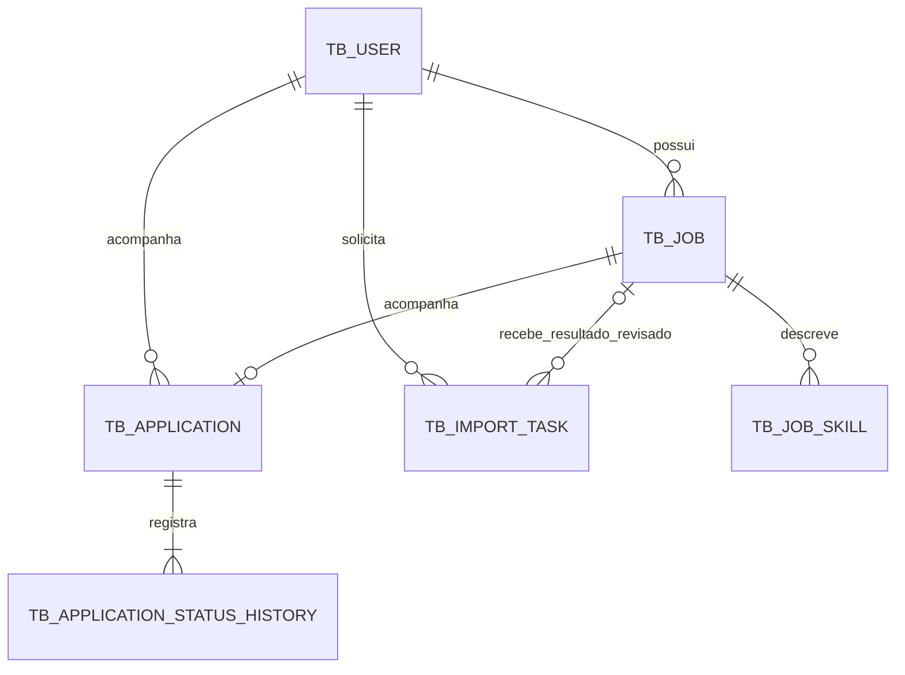

# Modelagem do banco — Acompanhaai

Modelo baseado na conversa “Desenhar backend para vagas”. A implementação foi integrada em 28/10/2026 com as alterações da outra conversa: V1 para usuários, V2 para fotos, V3 para vagas/candidaturas/histórico, V4 para detalhes da vaga e habilidades e V5 para importações. O CRUD de candidaturas e a gravação transacional do histórico já existem; confirmação de importação e worker continuam pendentes. O Flyway aplica as tabelas ao iniciar a aplicação.

## Escopo e decisões

- PostgreSQL como banco principal; Java 25, Spring Boot 4, JPA e Flyway já definidos no projeto.
- Cada usuário tem seu próprio conjunto de vagas, candidaturas e importações. A mesma URL pode existir para usuários diferentes.
- Salvar uma vaga não significa realizar uma candidatura. O acompanhamento começa em `SAVED`, sem data de inscrição.
- No MVP, cada usuário tem no máximo um acompanhamento por vaga. Uma nova candidatura à mesma oportunidade será uma evolução futura, caso necessária.
- Vagas são cópias pessoais editáveis. Empresa fica como texto na vaga; um catálogo compartilhado de empresas não é necessário para o fluxo atual.
- A extração produz uma proposta de dados; somente a revisão do usuário cria ou atualiza a vaga definitiva.

## Relacionamentos



A relação com importações é opcional: uma tarefa pode falhar ou aguardar revisão sem existir uma vaga. Várias tarefas podem ter como destino a mesma vaga, em reimportações.

## Convenções

- PKs: `BIGINT GENERATED BY DEFAULT AS IDENTITY`, seguindo `tb_user`.
- Instantes: `TIMESTAMP WITH TIME ZONE`, mapeados para `Instant`. A interface apresenta o fuso do usuário.
- Datas informadas sem horário: `DATE`, mapeadas para `LocalDate`.
- Valores monetários: `NUMERIC(15,2)`, mapeados para `BigDecimal`.
- Estados: `VARCHAR(32)` com `CHECK`, mapeados por `EnumType.STRING`; nunca ordinal.
- `created_at` e `updated_at` obrigatórios nas novas entidades mutáveis; aplicação mantém os horários em cada escrita.
- `version BIGINT NOT NULL DEFAULT 0` em vaga e candidatura, mapeado com `@Version`, para detectar edições concorrentes.
- Obrigatório significa `NOT NULL`. Textos obrigatórios também devem rejeitar conteúdo vazio após `trim`.

## 1. tb_user — existente

Preservar `id`, `name`, `email`, `password_hash`, `auth_version` e `created_at`, definidos pela migração V1. `auth_version` é usado pela autenticação para invalidar sessões.

O email deve ser normalizado da mesma forma no cadastro, edição e login. A unicidade atual é sobre o valor armazenado; revisar a coerência da normalização antes de acrescentar outra estratégia de índice.

## 2. tb_job — oportunidade revisada

| Campo | Tipo | Obrigatório | Finalidade |
|---|---|---|---|
| id | BIGINT | Sim | Identificador |
| user_id | BIGINT FK | Sim | Proprietário |
| title | VARCHAR(255) | Sim | Nome da vaga |
| company_name | VARCHAR(255) | Não | Empresa; pode estar ausente no anúncio |
| source_url | VARCHAR(2048) | Não | Link original; cadastro por texto pode não ter link |
| normalized_url | TEXT | Não | URL após normalização conservadora |
| url_hash | VARCHAR(64) | Não | SHA-256 hexadecimal da URL normalizada |
| description | TEXT | Não | Descrição preservada para consulta |
| location | VARCHAR(255) | Não | Localização declarada |
| work_mode | VARCHAR(32) | Não | REMOTE, HYBRID ou ONSITE |
| salary_min | NUMERIC(15,2) | Não | Limite inferior informado |
| salary_max | NUMERIC(15,2) | Não | Limite superior informado |
| salary_currency | VARCHAR(3) | Não | Código da moeda, por exemplo BRL |
| salary_period | VARCHAR(32) | Não | HOUR, DAY, WEEK, MONTH ou YEAR |
| salary_original_text | TEXT | Não | Texto do anúncio, inclusive “a combinar” |
| created_at / updated_at | TIMESTAMP WITH TIME ZONE | Sim | Auditoria básica |
| version | BIGINT | Sim | Controle de concorrência |

Regras:

- Ausência de salário é `NULL`. Nunca preencher com zero, salário estimado, moeda ou periodicidade presumidas.
- Salário exato preenche mínimo e máximo com o mesmo valor; “a partir de” preenche apenas mínimo; “até” preenche apenas máximo.
- Valores presentes devem ser não negativos; se ambos existirem, máximo deve ser maior ou igual ao mínimo.
- Novos registros pelo CRUD preenchem link, URL normalizada e hash juntos. A migração permite registros legados com apenas o link; é necessário preencher o hash desses registros antes de obter deduplicação completa da base antiga.
- `UNIQUE (user_id, url_hash)` evita duplicatas por URL normalizada no conjunto pessoal. Cadastros sem URL não são deduplicados automaticamente.
- Ao detectar o mesmo hash, conferir também a URL normalizada e rejeitar eventual colisão sem unir registros.
- A implementação inicial calcula o hash da URL recebida, após remover espaços nas extremidades. Uma normalização futura pode remover parâmetros reconhecidos de rastreamento, preservando os que identificam a oportunidade. URLs diferentes para a mesma vaga ainda podem gerar registros distintos.

## 3. tb_job_skill — habilidades da vaga

| Campo | Tipo | Obrigatório | Finalidade |
|---|---|---|---|
| id | BIGINT | Sim | Identificador |
| job_id | BIGINT FK | Sim | Vaga |
| name | VARCHAR(150) | Sim | Nome apresentado, como Java ou Comunicação |
| normalized_name | VARCHAR(150) | Sim | Nome normalizado para deduplicação |
| type | VARCHAR(32) | Sim | HARD ou SOFT |
| source_excerpt | TEXT | Não | Trecho que sustenta a extração |

`UNIQUE (job_id, type, normalized_name)`. Inicialmente, normalizar espaços e caixa; não unir sinônimos automaticamente. Habilidades inseridas manualmente podem não ter trecho de origem. Não armazenar habilidades como uma lista separada por vírgulas.

## 4. tb_application — acompanhamento pessoal

| Campo | Tipo | Obrigatório | Finalidade |
|---|---|---|---|
| id | BIGINT | Sim | Identificador |
| user_id | BIGINT FK | Sim | Proprietário |
| job_id | BIGINT FK | Sim | Vaga acompanhada |
| status | VARCHAR(32) | Sim | Estado atual |
| applied_on | DATE | Não | Data de inscrição, quando conhecida |
| notes | TEXT | Não | Observações pessoais |
| created_at / updated_at | TIMESTAMP WITH TIME ZONE | Sim | Auditoria básica |
| version | BIGINT | Sim | Controle de concorrência |

Estados: `SAVED`, `APPLIED`, `SCREENING`, `INTERVIEW`, `OFFER`, `HIRED`, `REJECTED`, `WITHDRAWN`.

- `SAVED` significa interesse salvo e exige `applied_on IS NULL`.
- Nos demais estados, a data pode continuar desconhecida; não inventar uma data ao importar registros antigos.
- Permitir pular etapas e corrigir o status. Retornar para SAVED exige limpar a data e registra a correção no histórico.
- `UNIQUE (user_id, job_id)` limita a um acompanhamento por vaga no MVP.
- O `user_id` deve ser igual ao proprietário da vaga, garantido por FK composta descrita abaixo.

## 5. tb_application_status_history — histórico

| Campo | Tipo | Obrigatório | Finalidade |
|---|---|---|---|
| id | BIGINT | Sim | Identificador |
| application_id | BIGINT FK | Sim | Acompanhamento |
| from_status | VARCHAR(32) | Não | Estado anterior; nulo somente no evento inicial |
| to_status | VARCHAR(32) | Sim | Estado registrado |
| changed_at | TIMESTAMP WITH TIME ZONE | Sim | Momento do registro |
| note | TEXT | Não | Explicação opcional |

Criar o primeiro evento junto com a candidatura. Mudanças de status atualizam `tb_application` e inserem o histórico na mesma transação. Rejeitar eventos sem mudança de estado; uma edição apenas de observações não cria evento de status. O histórico não é editado pelo CRUD comum. A consistência entre estado atual e último evento depende dessa transação; uma FK isolada não a garante.

## 6. tb_import_task — coleta e extração

| Campo | Tipo | Obrigatório | Finalidade |
|---|---|---|---|
| id | BIGINT | Sim | Identificador |
| user_id | BIGINT FK | Sim | Solicitante |
| job_id | BIGINT FK | Não | Vaga de destino após confirmação |
| input_type | VARCHAR(32) | Sim | URL ou TEXT |
| source_url | TEXT | Não | URL de entrada |
| input_text | TEXT | Não | Descrição colada |
| collected_text | TEXT | Não | Texto obtido pelo coletor |
| status | VARCHAR(32) | Sim | Estado do processamento |
| attempt_count | INTEGER | Sim | Tentativas iniciadas, padrão 0 |
| next_attempt_at | TIMESTAMP WITH TIME ZONE | Não | Próxima execução permitida |
| locked_until | TIMESTAMP WITH TIME ZONE | Não | Validade da posse do processamento |
| lock_token | VARCHAR(36) | Não | Token que identifica a execução atual |
| started_at / finished_at | TIMESTAMP WITH TIME ZONE | Não | Execução mais recente |
| extractor_provider / extractor_model | VARCHAR(100) | Não | Origem do resultado |
| result_schema_version | INTEGER | Não | Versão do formato do resultado |
| extracted_data | JSONB | Não | Proposta estruturada validada |
| error_code | VARCHAR(100) | Não | Erro categorizado |
| error_message | TEXT | Não | Diagnóstico sem credenciais |
| reviewed_at | TIMESTAMP WITH TIME ZONE | Não | Confirmação do usuário |
| created_at / updated_at | TIMESTAMP WITH TIME ZONE | Sim | Auditoria básica |

Estados: `PENDING`, `PROCESSING`, `READY_FOR_REVIEW`, `NEEDS_INPUT`, `FAILED`, `COMPLETED`.

- URL exige `source_url` preenchido e `input_text` nulo; TEXT exige a condição inversa. Texto coletado fica em coluna separada.
- `READY_FOR_REVIEW` significa extração finalizada; `COMPLETED` significa resultado confirmado e vinculado à vaga. Rejeitar segunda confirmação da mesma tarefa.
- `attempt_count >= 0`; tentativas e tempo de processamento devem ter limites na aplicação.
- Um worker deve reivindicar a tarefa atomicamente. Conclusão exige o token da execução atual; tarefas com posse expirada podem ser recuperadas sem aceitar a escrita de um worker antigo.
- Ao confirmar: validar os dados revisados, criar/atualizar vaga e habilidades, e concluir a tarefa na mesma transação. Não criar candidatura automaticamente.
- Reimportação mantém o resultado separado até nova revisão e usa a versão da vaga para detectar mudanças concorrentes.
- JSONB fica restrito ao resultado variável da extração; filtros de vagas usam as colunas relacionais.
- Definir limites de tamanho e política de expiração do texto coletado/resultados antes de habilitar a importação. O registro final da vaga deve sobreviver à limpeza das tarefas.

## Integridade e isolamento

Além das FKs simples, criar `UNIQUE (id, user_id)` em `tb_job` e estas referências:

```sql
FOREIGN KEY (job_id, user_id) REFERENCES tb_job (id, user_id)
```

Aplicar em `tb_application` e `tb_import_task`. Assim, um acompanhamento ou importação não pode apontar para a vaga de outro usuário. Para importação sem vaga, `job_id` nulo é permitido.

O backend obtém o usuário da sessão autenticada e sempre consulta registros com filtro de proprietário. Habilidades e histórico são acessados através da vaga/candidatura pertencente ao usuário; nunca confiar apenas no ID recebido.

Proposta de exclusão física para o MVP:

- Excluir conta remove seus dados pessoais, vagas, candidaturas, habilidades, históricos e tarefas em uma transação.
- Excluir vaga remove suas habilidades, acompanhamento/histórico e tarefas vinculadas por cascata.
- No CRUD atual, excluir uma candidatura remove seu histórico e a vaga pessoal criada junto com ela. Uma operação que preserve a vaga poderá ser oferecida quando houver cadastro independente de oportunidades.
- Excluir tarefa não remove a vaga já confirmada.
- Aplicar CASCADE de usuário para os registros próprios, de vaga para habilidades/candidatura/tarefas e de candidatura para histórico. Não usar SET NULL na FK composta de tarefa para vaga, pois user_id é obrigatório.
- Workers devem aceitar a remoção de tarefas durante execução: se o registro/token não existir mais, descartar o resultado.

Essas regras são decisões propostas de produto; não há soft delete nem promessa de recuperação após exclusão neste MVP.

## Índices iniciais

| Tabela | Índice | Consulta atendida |
|---|---|---|
| tb_job | UNIQUE (user_id, url_hash) | Duplicatas pessoais |
| tb_job | (user_id, created_at DESC, id DESC) | Listagem paginada |
| tb_job | UNIQUE (id, user_id) | Alvo das FKs compostas |
| tb_job_skill | UNIQUE (job_id, type, normalized_name) | Habilidades e deduplicação |
| tb_application | UNIQUE (user_id, job_id) | Acompanhamento único |
| tb_application | (job_id, user_id) | Referência à vaga e exclusão |
| tb_application | (user_id, status, updated_at DESC, id DESC) | Quadro por status |
| tb_application_status_history | (application_id, changed_at, id) | Linha do tempo |
| tb_import_task | (user_id, created_at DESC, id DESC) | Importações do usuário |
| tb_import_task | (job_id, user_id) | Referência à vaga e exclusão |
| tb_import_task | (status, next_attempt_at, id) | Tarefas prontas para execução |
| tb_import_task | (status, locked_until, id) | Recuperação de tarefas interrompidas |

Avaliar novos índices a partir das consultas reais. Não criar índice em todo campo, nem GIN no JSONB sem necessidade de consulta.

## Ordem de implementação

1. Preservar a V1 de usuários e a autenticação existente.
2. Entidades e migrações de estrutura concluídas: V3 para vagas/candidaturas/histórico, V4 para detalhes e habilidades, V5 para tarefas de importação.
3. Cadastro manual e transações de acompanhamento/histórico integrados com o CRUD da outra conversa.
4. Adicionar tarefa de importação e seu worker quando o fluxo manual estiver funcional.
5. Validar constraints, isolamento entre usuários e concorrência em PostgreSQL. Testes em H2 não comprovam o comportamento de JSONB e do worker no PostgreSQL.

## Referências técnicas

- [PostgreSQL — constraints](https://www.postgresql.org/docs/current/ddl-constraints.html): FK composta, unicidade e CHECK. CHECK não substitui NOT NULL e não deve validar dados de outra tabela.
- [PostgreSQL — tipos numéricos](https://www.postgresql.org/docs/current/datatype-numeric.html): NUMERIC oferece representação decimal exata para valores monetários.
